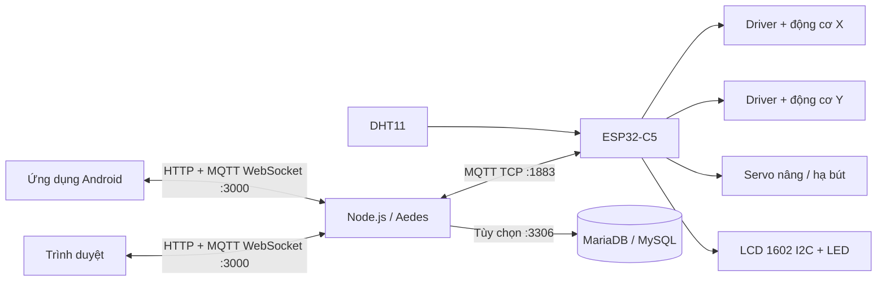

# MiniCNC — Máy vẽ CNC 2 trục qua Wi-Fi/MQTT

MiniCNC là hệ thống điều khiển máy vẽ dùng **ESP32-C5**, hai động cơ bước X/Y và servo nâng/hạ bút. Người dùng điều khiển từ trình duyệt hoặc ứng dụng Android, vẽ hình học, chuyển ảnh thành đường chạy và theo dõi trạng thái máy theo thời gian thực.

Repository chứa mã nguồn web, broker Node.js, firmware PlatformIO, ứng dụng Android, schema MariaDB/MySQL và dự án mô phỏng Wokwi. Có thể build trực tiếp từ bố cục này, không cần thư mục PlatformIO riêng trên máy tác giả.

> Hướng dẫn dưới đây bám theo mã nguồn trong repository. Đây là máy vẽ bút hai trục; firmware hiện không có bộ đọc G-code, điều khiển spindle/laser, encoder hoặc công tắc hành trình. Nút **GỐC** trở về gốc phần mềm đã đặt.

## Mục lục

- [1. Chức năng](#1-chức-năng)
- [2. Kiến trúc và công nghệ](#2-kiến-trúc-và-công-nghệ)
- [3. Cấu trúc thư mục](#3-cấu-trúc-thư-mục)
- [4. Phần cứng và cách đấu dây](#4-phần-cứng-và-cách-đấu-dây)
- [5. Chạy broker và web](#5-chạy-broker-và-web)
- [6. Build, nạp và cấu hình ESP32](#6-build-nạp-và-cấu-hình-esp32)
- [7. Sử dụng và hiệu chỉnh](#7-sử-dụng-và-hiệu-chỉnh)
- [8. Database tùy chọn](#8-database-tùy-chọn)
- [9. Ứng dụng Android](#9-ứng-dụng-android)
- [10. Mô phỏng](#10-mô-phỏng)
- [11. Giao thức MQTT và HTTP](#11-giao-thức-mqtt-và-http)
- [12. Kiểm thử và giới hạn hiện tại](#12-kiểm-thử-và-giới-hạn-hiện-tại)
- [13. Xử lý sự cố](#13-xử-lý-sự-cố)
- [14. Đưa mã nguồn lên GitHub](#14-đưa-mã-nguồn-lên-github)

## 1. Chức năng

| Nhóm | Chức năng hiện có |
| --- | --- |
| Điều khiển thủ công | Jog X trái/phải, Y lên/xuống; chọn bước 10/50/100; trở về gốc; đặt gốc và chốt giới hạn hành trình |
| Tốc độ | Thanh chỉnh 100–800 bước/giây trên web; mặc định 300; firmware giới hạn lệnh tốc độ trong 80–800 bước/giây |
| Bút và đèn | Nâng/hạ bút, chỉnh góc servo 0–180°, lưu góc vào NVS; bật/tắt LED chiếu sáng; LED riêng báo nhận lệnh |
| Vẽ hình | Vẽ khung theo toàn bộ giới hạn X/Y; vẽ hình tròn ở giữa vùng làm việc, đường kính bằng 80% chiều ngắn hơn |
| Vẽ từ ảnh | Nhận ảnh tối đa 15 MB; kéo thả, di chuyển, thay đổi kích thước, căn giữa/vừa khung; xem ảnh trắng đen và đường chạy trước khi gửi |
| Xử lý ảnh | Vẽ viền hoặc tô bằng nét ngang; chỉnh ngưỡng trắng đen, khoảng cách nét tô 1–20 đơn vị hiển thị mm (mặc định 3), tùy chọn thêm khung ảnh |
| Quản lý bản vẽ | Nạp theo từng gói và chờ ESP32 xác nhận số lệnh; bắt đầu sau khi nhận đủ; hiển thị phần trăm, số điểm, trạng thái; hủy nạp/hủy vẽ |
| Giám sát | Tọa độ X/Y, phạm vi hành trình, góc/trạng thái bút, LED, tiến độ; đồng hồ và đồ thị vị trí, nhiệt độ/độ ẩm DHT11; nhật ký sự kiện |
| Kết nối | Đăng nhập MQTT qua WebSocket; phân biệt broker kết nối với ESP32 trực tuyến; tự kết nối lại và khóa điều khiển khi mất telemetry |
| Cấu hình mạng | Portal Wi-Fi trên ESP32 tại `192.168.4.1`; đổi Wi-Fi/broker từ nút AP Mode; lưu cấu hình trong flash NVS |
| Firmware | Nội suy Bresenham hai trục, tăng/giảm tốc; lưu giới hạn và hệ số quy đổi; tự nhấc bút và ngắt lực motor khi không hoạt động |
| Android | Dùng chung giao diện web, đóng gói font/tài nguyên để mở offline; kết nối broker trong LAN; năm mục Điều khiển/Vẽ hình/Vẽ ảnh/Giám sát/Cài đặt |
| Lưu dữ liệu | Broker có thể lưu nhật ký lệnh, trạng thái, dữ liệu môi trường và metadata ảnh vào MariaDB/MySQL |
| Mô phỏng | Mô phỏng giao diện không cần ESP32; dự án Wokwi riêng chạy logic firmware và trao đổi MQTT thật với broker |

**Lưu ý về kích thước:** giao diện dùng nhãn mm, nhưng thao tác **Đặt limit** trực tiếp đặt hệ số bằng 1. Muốn kích thước vật lý và hình tròn đúng trên cơ khí của bạn, cần hiệu chỉnh bằng số đo thực theo mục 7. Tô màu là tô bằng các nét của một bút, không phải in ảnh nhiều màu.

## 2. Kiến trúc và công nghệ



- **Web:** HTML/CSS/JavaScript, Canvas, MQTT.js, ECharts; broker phục vụ trực tiếp thư mục `web/`, không cần build frontend để chạy trình duyệt.
- **Broker:** Node.js, Aedes, `ws`, `mysql2`; cùng một tiến trình phục vụ web, MQTT TCP và MQTT qua WebSocket.
- **Firmware:** C++/Arduino trên PlatformIO, board `esp32-c5-devkitc-1`, PubSubClient, ArduinoJson, DHT và LiquidCrystal_I2C.
- **Android:** Capacitor 8; mã giao diện lấy từ `web/` khi build.
- **Lưu cấu hình:** tài khoản broker trong `broker/users.json`; Wi-Fi/MQTT, hiệu chỉnh và góc bút trên ESP32 trong NVS.

| Địa chỉ/cổng mặc định | Dùng cho |
| --- | --- |
| `http://localhost:3000` | Dashboard trên chính máy chạy broker |
| `http://<IP-LAN-BROKER>:3000` | Dashboard trên máy khác/điện thoại cùng LAN |
| `ws://<IP-LAN-BROKER>:3000/mqtt` | WebSocket MQTT của web/Android |
| `<IP-LAN-BROKER>:1883` | MQTT TCP của ESP32 |
| `http://192.168.4.1` | Portal do ESP32 phát khi ở chế độ AP; không phải dashboard |
| `127.0.0.1:3306` | Database tùy chọn trên máy broker |

Máy chạy broker phải hoạt động khi điều khiển. ESP32 và thiết bị người dùng cần truy cập được máy này. Không nhập `localhost` trên ESP32/điện thoại để trỏ tới laptop.

## 3. Cấu trúc thư mục

```text
.
├── README.md
├── web/                         # Dashboard, xử lý ảnh, MQTT, đồng hồ/đồ thị
├── broker/
│   ├── broker.js                # MQTT TCP, WebSocket, HTTP, ACL và database
│   ├── users.json.example       # Mẫu tài khoản, không phải cấu hình sử dụng thật
│   └── package-lock.json
├── firmware/
│   ├── platformio.ini           # Build/nạp ESP32-C5 thật
│   ├── src/main.cpp             # Chuyển động, job, cảm biến, Wi-Fi, MQTT
│   ├── include/config.h         # GPIO và tham số mặc định
│   ├── include/config_ap.h      # SSID, mật khẩu và IP AP cấu hình
│   ├── include/secrets.h.example
│   └── test/                    # Test trên máy tính và dự án Wokwi riêng
├── mobile/                      # Capacitor, Android, script build và test
├── tests/                       # Test Node.js cho logic web/kết nối/upload
├── database/schema.sql          # Schema database
├── docs/                        # Tài liệu kiến trúc/khôi phục trước đây
├── recovery/                    # Dữ liệu khôi phục, không cần cho vận hành
└── firmware-recovered/          # Binary firmware cũ phục vụ đối chiếu
```

Các thư mục `.pio/`, `node_modules/`, `mobile/www/`, `mobile/artifacts/`, `.runtime/` là đầu ra build/cài đặt hoặc dữ liệu cục bộ. Dự án Wokwi dùng source tương đối trong `firmware/`; giữ nguyên bố cục khi clone.

## 4. Phần cứng và cách đấu dây

### 4.1. Linh kiện

| Linh kiện | Số lượng | Ghi chú |
| --- | --- | --- |
| ESP32-C5 DevKitC-1 | 1 | Đúng board đang cấu hình trong PlatformIO |
| Động cơ bước hai pha và cơ cấu trượt X/Y | 2 | Chọn theo dòng định mức và cơ khí thực tế |
| Driver A4988 | 2 | Bảng đấu dây dưới đây lấy A4988 làm mẫu; driver STEP/DIR khác phải đối chiếu pinout riêng |
| Servo nâng/hạ bút | 1 | Chọn nguồn đúng điện áp/dòng của servo |
| DHT11 | 1 | Firmware máy thật dùng DHT11 |
| LCD 1602 kèm backpack I2C | 1 | Địa chỉ mặc định `0x27`, firmware thử thêm `0x3F` |
| LED chiếu sáng nhỏ và LED báo hoạt động | 2 | Mỗi LED thường cần điện trở hạn dòng, ví dụ 330 Ω |
| Nguồn motor, nguồn servo, dây nối | Theo hệ thống | Không lấy nguồn motor từ GPIO/3V3 của ESP32 |
| Tụ lọc, điện trở kéo lên, chuyển mức I2C | Theo module | Xem hướng dẫn nguồn bên dưới |

### 4.2. Bảng GPIO của máy thật

Nguồn đối chiếu: [firmware/include/config.h](firmware/include/config.h). Số GPIO không phải số thứ tự chân trên hàng header.

| Tín hiệu | Chân ESP32-C5 | Nối tới |
| --- | --- | --- |
| X STEP | GPIO4 | STEP của driver X |
| X DIR | GPIO5 | DIR của driver X |
| X ENABLE | GPIO23 | ENABLE của driver X, mức LOW bật motor |
| Y STEP | GPIO24 | STEP của driver Y |
| Y DIR | GPIO0 | DIR của driver Y |
| Y ENABLE | GPIO1 | ENABLE của driver Y, mức LOW bật motor |
| Servo | GPIO8 | Dây tín hiệu/PWM servo |
| DHT11 | GPIO9 | DATA cảm biến |
| LED chiếu sáng | GPIO6 | Điện trở → anode LED; cathode → GND |
| LED hoạt động | GPIO3 | Điện trở → anode LED; cathode → GND |
| LCD SDA | GPIO10 | SDA của LCD qua chuyển mức nếu cần |
| LCD SCL | `TX` / GPIO11 | SCL của LCD qua chuyển mức nếu cần |
| GND | GND | Mass chung ESP32, driver, cảm biến và nguồn ngoại vi |

Trong firmware thật, `PIN_LCD_SCL` mặc định bằng ký hiệu `TX`. Trên ESP32-C5 DevKitC-1, TX là GPIO11 theo [pinout chính thức của Espressif](https://docs.espressif.com/projects/esp-dev-kits/en/latest/esp32c5/esp32-c5-devkitc-1/user_guide.html). Không dùng đồng thời GPIO11 cho LCD và UART TX. Cấu hình hiện bật USB CDC để theo dõi Serial qua USB của chip.

**Wokwi dùng SCL = GPIO7**, khác máy thật để dành UART cho Serial Monitor. Không sao chép nguyên sơ đồ Wokwi sang phần cứng mà bỏ qua khác biệt này.

### 4.3. Đấu hai driver A4988

Thực hiện cho từng driver X/Y:

| Chân A4988 | Cách nối |
| --- | --- |
| VDD | Logic 3,3 V từ ESP32 |
| GND logic | GND chung |
| STEP, DIR, ENABLE | Theo bảng GPIO ở trên |
| RESET và SLEEP | Nối với nhau và giữ mức HIGH theo sơ đồ module, ví dụ kéo lên VDD |
| MS1, MS2, MS3 | Chọn chế độ vi bước theo bảng của driver; giữ cấu hình cố định sau hiệu chỉnh |
| 1A, 1B | Hai dây của cùng một cuộn motor |
| 2A, 2B | Hai dây của cuộn motor còn lại |
| VMOT và GND nguồn | Nguồn motor riêng, đúng định mức driver/motor |

A4988 carrier của Pololu dùng nguồn logic 3–5,5 V và nguồn motor 8–35 V; hãng hướng dẫn đặt tụ điện phân ít nhất 47 µF sát VMOT–GND để giảm xung áp. Module khác cần kiểm tra tài liệu tương ứng. Xác định cặp cuộn bằng đồng hồ đo, chỉnh giới hạn dòng trước khi chạy và ngắt nguồn trước khi cắm/rút motor. Xem [hướng dẫn A4988 của Pololu](https://www.pololu.com/product/1182).

Firmware có thể phát STEP/DIR cho DRV8825, nhưng không áp dụng nguyên bảng nguồn/chân của A4988 cho DRV8825. Thay chế độ vi bước, driver, dây đai hoặc vít me cần hiệu chỉnh lại hệ số xung/đơn vị.

### 4.4. Servo, cảm biến, LCD và nguồn

- **Servo:** tín hiệu vào GPIO8, nguồn riêng phù hợp servo, GND nối chung ESP32. Mặc định nhấc bút 110°, hạ bút 80°, chờ 250 ms khi đổi trạng thái/góc. Điều chỉnh theo cơ cấu để tránh ép bút hoặc kẹt servo.
- **DHT11:** DATA vào GPIO9, GND chung. Chọn module có nguồn/logic phù hợp 3,3 V; nếu cấp cảm biến ở điện áp cao hơn, bảo đảm DATA về ESP32 không vượt mức logic của chip. Cảm biến rời cần điện trở kéo lên DATA theo datasheet; module có thể đã tích hợp.
- **LCD I2C:** SDA/SCL theo bảng. Backpack chạy 5 V thường kéo bus lên VCC: dùng chuyển mức I2C hai chiều phù hợp giữa phía ESP32 3,3 V và LCD 5 V. Không mặc định bus 5 V có thể nối thẳng vào GPIO.
- **LED:** bảng GPIO dành cho LED tín hiệu dòng nhỏ có điện trở. Đèn công suất cần tầng transistor/MOSFET và nguồn riêng.
- **Nguồn:** tách đường cấp motor/servo khỏi đường nguồn logic, nối mass chung; kiểm tra cực tính và dòng nguồn. Khi ESP32 đang được cấp USB, tránh nối thêm nguồn vào chân nguồn board nếu chưa đối chiếu sơ đồ cấp nguồn của board.

```text
GPIO X STEP/DIR/EN ──> Driver X ──> Motor X
GPIO Y STEP/DIR/EN ──> Driver Y ──> Motor Y
Nguồn motor (+) ─────> VMOT của hai driver
Nguồn motor (−) ─────┐
Nguồn servo (−) ─────┼── GND chung ── ESP32 GND
GND driver/cảm biến ─┘
Nguồn servo (+) ─────> Servo V+
GPIO8 ──────────────> Servo Signal
```

Sơ đồ [Wokwi](firmware/test/wokwi/diagram.json) phục vụ kiểm tra logic; mô phỏng không xác nhận khả năng cấp nguồn, giới hạn dòng hay mức điện áp của mạch thật.

## 5. Chạy broker và web

### 5.1. Chuẩn bị

- Cài Node.js 22+ và npm để dùng thống nhất với toolchain Android của dự án.
- Tải/clone repository và mở terminal tại thư mục gốc.
- Cho máy broker, ESP32 và điện thoại vào mạng có thể truy cập lẫn nhau; tránh Wi-Fi khách bật client isolation.

Các ví dụ dưới đây dùng PowerShell trên Windows.

```powershell
cd broker
npm ci
if (!(Test-Path users.json)) { Copy-Item users.json.example users.json }
```

Sửa `broker/users.json` trước khi vận hành. Ví dụ cấu trúc, **thay các chuỗi mật khẩu mẫu bằng mật khẩu của bạn**:

```json
{
  "users": {
    "device01": "THAY_MAT_KHAU_THIET_BI",
    "operator01": "THAY_MAT_KHAU_DIEU_KHIEN",
    "admin": "THAY_MAT_KHAU_QUAN_TRI"
  },
  "admins": ["admin"],
  "operators": ["operator01"]
}
```

Dùng `device01` cho firmware và `operator01` cho người điều khiển. `users.json.example` có `user1 / 1` để thử Wokwi; đây là tài khoản demo. Broker còn nhánh tương thích mật khẩu cũ cho tên `cnc`; với cấu hình mới nên dùng tên thiết bị riêng như trên và bỏ tài khoản `cnc` khỏi `users.json`.

### 5.2. Khởi chạy

Tại `broker/`:

```powershell
npm start
```

Giữ terminal này chạy, rồi mở **http://localhost:3000**. Điện thoại/máy khác mở `http://<IP-LAN-BROKER>:3000`; IP có trong log broker hoặc xem bằng `ipconfig`. Trình duyệt tự kết nối broker cùng địa chỉ trang đang mở, không cần nhập IP/cổng riêng trên web.

Kiểm tra HTTP từ terminal khác:

```powershell
Invoke-RestMethod http://localhost:3000/healthz
```

Kết quả có `ok: true`, `device: cnc01` và `lock`. `/healthz` phản ánh broker, chưa chứng minh ESP32 đã online. Sau đăng nhập, chờ thông báo **ESP32 trực tuyến** từ telemetry trực tiếp.

Nếu chỉ localhost truy cập được, cho phép Node.js và TCP `3000`, `1883` qua firewall trên mạng LAN đang dùng. Script [broker/fix-firewall.ps1](broker/fix-firewall.ps1) là tiện ích Windows cần quyền quản trị; đọc trước khi chạy vì nó áp dụng cho cả profile Public và giả định vị trí Node.js mặc định.

### 5.3. Biến môi trường

| Biến | Mặc định | Ý nghĩa |
| --- | --- | --- |
| `BIND_HOST` | `0.0.0.0` | Địa chỉ lắng nghe; dùng `127.0.0.1` nếu chỉ thử trên máy |
| `WEB_PORT` | `3000` | HTTP và WebSocket `/mqtt` |
| `MQTT_PORT` | `1883` | MQTT TCP cho ESP32 |
| `DEVICE_ID` | `cnc01` | Prefix topic mà broker chấp nhận |
| `WEB_PUBLIC_URL` | Tự tìm IP LAN | URL in trong log, không cấu hình TLS/proxy |

Ví dụ đổi cổng tại `broker/`:

```powershell
$env:WEB_PORT = '3001'
$env:MQTT_PORT = '1884'
npm start
```

Sau đó mở web cổng `3001`, cấu hình ESP32 dùng MQTT cổng `1884`. Nếu đổi `DEVICE_ID`, sửa cả hằng `DEVICE_ID` trong firmware và build/nạp lại; web lấy ID từ `/healthz`. Một broker hiện được cấu hình cho một device ID.

## 6. Build, nạp và cấu hình ESP32

### 6.1. Build và nạp

Cài PlatformIO Core hoặc extension PlatformIO trong VS Code. Tại thư mục gốc repository:

```powershell
cd firmware
pio run -e esp32c5
pio device list
```

Khi đã nối đúng ESP32-C5 và xác định cổng:

```powershell
pio run -e esp32c5 -t upload --upload-port COM8
pio device monitor --port COM8 --baud 115200
```

Thay `COM8` bằng cổng thực tế (`platformio.ini` hiện mặc định COM8). Nếu lệnh `pio` không có trong PATH trên Windows, dùng executable của PlatformIO, ví dụ:

```powershell
& "$env:USERPROFILE/.platformio/penv/Scripts/platformio.exe" run -e esp32c5
```

Lần build đầu cần mạng để tải platform và thư viện. Platform đang lấy từ URL `stable` của pioarduino trong [platformio.ini](firmware/platformio.ini); đây không phải phiên bản toolchain đã khóa cố định. Không nạp binary của dự án Wokwi lên máy thật.

### 6.2. Cấu hình bằng Wi-Fi AP

1. Chạy broker trước. Cấp nguồn/khởi động ESP32.
2. Khi chưa có cấu hình hợp lệ, ESP32 mở Wi-Fi **KimPang**, mật khẩu mặc định **12345678**.
3. Kết nối Wi-Fi này, giữ DHCP/IP tự động và chọn tiếp tục kết nối nếu điện thoại báo không có Internet.
4. Mở **http://192.168.4.1** bằng trình duyệt.
5. Nhập SSID/mật khẩu Wi-Fi, IP hoặc hostname máy broker, cổng MQTT **1883**, username/password của tài khoản thiết bị trong `users.json`.
6. Lưu; ESP32 khởi động lại. Đưa điện thoại/laptop trở về mạng của broker và mở dashboard.
7. Đăng nhập tài khoản operator; chờ ESP32 trực tuyến rồi mới điều khiển.

Nếu Wi-Fi thất bại sau khoảng 15 giây hoặc MQTT không nối được trong cửa sổ thử khoảng 30 giây lúc khởi động, thiết bị quay về AP. Broker từ chối thông tin đăng nhập thì quay về AP ngay. Sau khi đã vào chế độ điều khiển, mất mạng sử dụng cơ chế reconnect, không tự chuyển sang AP theo cửa sổ khởi động này.

### 6.3. Đổi mạng và mặc định cục bộ

Khi đang online, bấm **Đổi WiFi / Cài đặt lại WiFi (AP Mode)** và xác nhận trên giao diện. Firmware dừng job, nhấc bút, ngắt lực motor rồi khởi động lại vào portal. Cấu hình cũ được giữ để điền sẵn phần không bí mật; nhập lại mật khẩu Wi-Fi khi lưu vì để trống có nghĩa là mạng mở. Xem [hướng dẫn cấu hình mạng](firmware/test/NETWORK-CONFIG.md).

Cũng có thể đặt mặc định khi biên dịch, tại `firmware/`:

```powershell
Copy-Item include/secrets.h.example include/secrets.h
```

Điền `WIFI_SSID`, `WIFI_PASSWORD`, `MQTT_HOST`, `MQTT_PORT`, `MQTT_USER`, `MQTT_PASSWORD`. Thêm `WIFI_AP_SSID` và `WIFI_AP_PASSWORD` nếu muốn đổi AP; khi đó dùng thông tin mới thay cho hướng dẫn KimPang trên giao diện.

`secrets.h` đã được gitignore. **NVS đã lưu được ưu tiên hơn mặc định biên dịch**; sửa file này rồi nạp lại không tự ghi đè mạng đã lưu. Dùng portal để thay cấu hình đang sử dụng.

## 7. Sử dụng và hiệu chỉnh

### 7.1. Lần chạy đầu

1. Kiểm tra dây/nguồn/giới hạn dòng driver; để vùng di chuyển trống và nhấc bút khỏi giấy.
2. Đăng nhập bằng tài khoản thuộc `operators` hoặc `admins`. Tắt **Mô phỏng** nếu đang dùng máy thật.
3. Chọn tốc độ thấp và bước jog nhỏ, thử riêng từng trục. Nếu ngược chiều, chỉnh `INVERT_X_DIR`/`INVERT_Y_DIR` trong `firmware/include/config.h`, build/nạp lại.
4. Đưa đầu bút tới góc gốc mong muốn rồi bấm **Đặt gốc**. Thao tác này đặt vị trí hiện tại thành `(0,0)`, không tìm gốc bằng cảm biến.
5. Jog từng trục tới phạm vi làm việc mong muốn rồi bấm **Đặt limit**. Giới hạn phải nằm bên trong hành trình cơ khí, không ép vào chặn cuối.
6. Chỉnh góc nhấc/hạ bút phù hợp; thử về **GỐC**. Chỉ vẽ khung toàn bàn khi đã kiểm tra cả hai giới hạn.

Jog dùng đơn vị tọa độ logic. Với scale bằng 1, bước 10 tương ứng 10 xung; sau hiệu chỉnh đo thực, bước 10 tương ứng 10 đơn vị mm logic. Tốc độ vẫn tính theo bước/giây.

### 7.2. Phân biệt đặt limit trực tiếp và đo mm

**Luồng nút trên web:** `Đặt gốc → Jog → Đặt limit`. Nút Đặt limit gửi payload rỗng, firmware lấy số xung hiện tại làm limit và đặt `axisScaleX = axisScaleY = 1`. Nếu một trục chưa di chuyển, nó dùng limit dự phòng của trục đó. Mặc định `230 × 850` là giới hạn tọa độ dự phòng, không phải kích thước bàn máy đã được đo là 230 × 850 mm.

**Luồng đo thực:** firmware còn hỗ trợ payload JSON trên topic `cnc/cnc01/control/cal/set`:

```json
{"travelX": 40, "travelY": 50}
```

Đây là ví dụ định dạng, không phải số đo mặc định. Sau khi đặt gốc và jog cả hai trục tới điểm đo, đo bằng thước khoảng dịch chuyển thực của mỗi trục rồi gửi số đo của bạn qua MQTT bằng tài khoản operator/admin, QoS 0 và `retain: false`. Giao diện hiện không có hai ô nhập số đo này; cần MQTT client riêng nếu dùng luồng đo thực.

Firmware tính `scaleX = số xung X / travelX`, tương tự cho Y; chấp nhận số đo 1–10000 mm và yêu cầu cả hai trục có dịch chuyển. Tọa độ đường vẽ hiện là số nguyên, limit làm tròn vào trong phạm vi đo. Sau khi đo, không bấm lại **Đặt gốc/Đặt limit trực tiếp** nếu muốn giữ hệ số vừa tính; các thao tác đó đặt scale về 1.

Không dựa riêng vào cờ `measuredCalibration` để kết luận đã đo mm: phiên bản hiện cũng bật cờ này trong luồng đặt trực tiếp. Hai bài kiểm tra liên quan được ghi rõ ở mục 12. Sau reset, mất bước hoặc dịch chuyển trục bằng tay, cần xác lập lại quan hệ giữa vị trí cơ khí và gốc logic trước khi chạy.

### 7.3. Vẽ hình và vẽ ảnh

- **Khung máy:** chạy bốn cạnh theo limit X/Y hiện tại. Tên giao thức là `square` nhưng khung có thể là hình chữ nhật.
- **Hình tròn:** lấy cùng bán kính ở X/Y, tâm ở giữa vùng làm việc; đường kính bằng 80% trục ngắn. Cơ khí cần đúng hệ số quy đổi hai trục để hình thật không bị méo.
- **Vẽ ảnh:** chọn PNG/JPEG hoặc ảnh trình duyệt đọc được, tối đa 15 MB → di chuyển/thu phóng/căn ảnh → chọn Vẽ viền hoặc Tô màu → chỉnh ngưỡng và khoảng cách nét → kiểm tra đường chạy → gửi tới ESP32.
- Ảnh tô quá dày tạo nhiều lệnh; tăng khoảng cách nét hoặc đơn giản hóa ảnh. Giao diện cảnh báo trên 3000 lệnh và chặn gửi trên **8000 lệnh**, tính cả nâng/hạ bút.
- Máy nhận toàn bộ bản vẽ trước khi chạy; khi hoàn thành, firmware nhấc bút và về gốc phần mềm.

### 7.4. Dừng và mất kết nối

**DỪNG MÁY / Hủy lệnh vẽ** hủy luồng nạp trên giao diện và gửi `control/stop`. Chỉ khi nhận status trực tiếp với `job.s = stop`, giao diện mới xác nhận đã dừng; quá 3,5 giây không có phản hồi sẽ báo chưa xác nhận được.

Mất telemetry quá 25 giây làm khóa gửi lệnh/hủy upload. Khi kết nối lại, giao diện không tự gửi lại bản vẽ. Tuy nhiên, ESP32 có thể tiếp tục chạy job đã nạp dù mất Wi-Fi/broker; nút dừng qua mạng không thay thế ngắt nguồn cơ cấu bằng phần cứng. Theo dõi máy trực tiếp nếu không nhận được xác nhận dừng.

Khi không chạy job và không có hoạt động trong khoảng 15 giây, firmware tự nhấc bút nếu đang hạ và ngắt lực motor. Khi motor hết giữ lực, dịch chuyển trục bằng tay sẽ làm tọa độ phần mềm không còn phản ánh vị trí thật.

## 8. Database tùy chọn

Web/broker vẫn hoạt động khi database không có; log sẽ báo MariaDB unavailable. Dữ liệu lúc database không sẵn sàng không được lưu để phát lại sau.

Schema: [database/schema.sql](database/schema.sql). Broker tự thử tạo database `minicnc` và các bảng khi kết nối thành công. Tài khoản database phải có quyền cần thiết cho các thao tác tạo schema/bảng hiện tại.

| Biến | Mặc định |
| --- | --- |
| `DB_HOST` | `127.0.0.1` |
| `DB_PORT` | `3306` |
| `DB_USER` | `root` |
| `DB_PASS` | Chuỗi rỗng |
| `DB_NAME` | `minicnc` |

Ví dụ tại `broker/`, sau khi đã chuẩn bị database/tài khoản:

```powershell
$env:DB_HOST = '127.0.0.1'
$env:DB_PORT = '3306'
$env:DB_USER = 'minicnc_app'
$env:DB_PASS = 'THAY_MAT_KHAU_DATABASE'
$env:DB_NAME = 'minicnc'
npm start
```

Không có bộ nạp `.env` trong broker; các biến trên phải được đặt trong môi trường tiến trình. Với `DB_NAME` khác `minicnc`, cần tạo database đích trước vì câu lệnh tạo database trong code vẫn dùng tên cố định `minicnc`.

| Bảng | Nội dung |
| --- | --- |
| `commands` | Tài khoản/client, topic điều khiển, payload và kết quả cho phép/chặn |
| `images` | Metadata ảnh gửi qua HTTP API: tên, MIME, dung lượng, SHA-256, đường dẫn |
| `status_log` | Payload JSON trạng thái ESP32 |
| `dht_log` | Nhiệt độ, độ ẩm và nhiệt độ chip |

File ảnh HTTP upload nằm tại `broker/uploads/`. Chọn ảnh trong giao diện để tạo đường vẽ là xử lý phía trình duyệt; không đồng nghĩa ảnh gốc đã được lưu lên server. Web hiện chưa có màn hình truy vấn lịch sử database.

## 9. Ứng dụng Android

Ứng dụng đóng gói giao diện từ `web/`, yêu cầu Android 7/API 24 trở lên. Vào **Cài đặt**, nhập **IP máy broker**, cổng web **3000** và tài khoản; không dùng IP ESP32 hoặc cổng MQTT TCP 1883 ở đây.

Build trên Windows cần Node 22+, JDK 21, Android SDK platform 36/build-tools 35.0.0; Gradle Wrapper có sẵn trong dự án. Từ thư mục gốc:

```powershell
cd mobile
npm ci
# Chỉ cần khi chưa có toolchain; script tải SDK/JDK và chấp nhận giấy phép SDK.
powershell -NoProfile -ExecutionPolicy Bypass -File scripts/setup-tools.ps1
npm test
npm run apk
```

Nếu dùng toolchain sẵn có, đặt `JAVA_HOME` và `ANDROID_HOME` theo hướng dẫn [mobile/README.md](mobile/README.md), không cần chạy setup. APK đầu ra: **`mobile/artifacts/MiniCNC-debug.apk`**, là bản debug cài nội bộ, không phải bản đã ký phát hành Play Store.

`npm run apk` build web, sync Capacitor, chạy Gradle `assembleDebug lintDebug`, sao chép APK và in SHA-256. Chỉ kiểm tra gói web dùng `npm run build`; chỉnh giao diện tại `web/` rồi build lại, không sửa bản sinh ra trong `mobile/www/`.

IP/cổng/tên đăng nhập được nhớ trên điện thoại; mật khẩu chỉ giữ trong phiên. Khi rời app, phiên đã điều khiển sẽ yêu cầu dừng nếu còn kết nối; trở lại chỉ đồng bộ trạng thái. Nếu hệ điều hành đóng tiến trình hoặc mạng mất, không bảo đảm lệnh dừng đến ESP32. Mở giao diện, xử lý ảnh và mô phỏng không cần Internet; điều khiển máy vẫn cần mạng tới broker.

## 10. Mô phỏng

### Mô phỏng trong giao diện

Vào **Cài đặt → Mô phỏng** để thử giao diện/đường vẽ khi không có ESP32. Bật chế độ này ngắt kết nối máy thật; số liệu mô phỏng không dùng để nghiệm thu GPIO, nguồn hoặc cơ khí.

### Mô phỏng firmware bằng Wokwi

1. Cài dependency và chạy broker như mục 5. Để dùng cấu hình Wokwi có sẵn, bảo đảm `user1 / 1` tồn tại và `user1` thuộc `operators`; nếu đổi tài khoản, sửa cả [cấu hình Wokwi](firmware/test/wokwi/include/config.h).
2. Build từ thư mục gốc:

   ```powershell
   powershell -NoProfile -ExecutionPolicy Bypass -File firmware/test/build-wokwi.ps1
   ```

   Hoặc tại `firmware/`: `pio run --project-dir test/wokwi -e wokwi`.

3. Trong VS Code, chọn **Wokwi: Select Config File → firmware/test/wokwi/wokwi.toml**, rồi **Start Simulator**.
4. Mở web tại `http://localhost:3000`, đăng nhập và **tắt mô phỏng nội bộ của giao diện** để lệnh đi qua MQTT tới Wokwi.

| Thông số | Wokwi |
| --- | --- |
| Wi-Fi | `Wokwi-GUEST`, không mật khẩu |
| Broker | `host.wokwi.internal:1883` |
| Device ID | `cnc01` |
| Cảm biến | DHT22 qua adapter, xuất dữ liệu theo giao thức DHT11 của web |
| LCD | SDA GPIO10, **SCL GPIO7** |
| Bộ đệm bản vẽ | 8000 lệnh; firmware máy thật là 12000 |

Kết nối tới broker local cần cơ chế gateway phù hợp của Wokwi; public gateway không truy cập được broker trên máy. Không chạy simulator và CNC thật cùng `cnc01` trên một broker vì lệnh có thể tới cả hai. Xem [hướng dẫn Wokwi](firmware/test/WOKWI.md) và [báo cáo mô phỏng](firmware/test/WOKWI-VALIDATION.md).

## 11. Giao thức MQTT và HTTP

### 11.1. Topic MQTT

Prefix mặc định: **`cnc/cnc01/`**. Các topic trong bảng là phần sau prefix.

| Topic | Payload / ý nghĩa |
| --- | --- |
| `status` | JSON từ ESP32: trạng thái, vị trí, cảm biến, hiệu chỉnh, job |
| `lock` | Username đang giữ khóa công việc do broker công bố; chuỗi rỗng là không khóa |
| `control/jog/x/left`, `control/jog/x/right` | Số đơn vị dịch chuyển X, ví dụ `10` |
| `control/jog/y/up`, `control/jog/y/down` | Số đơn vị dịch chuyển Y |
| `control/speed` | Số bước/giây |
| `control/home` | Payload rỗng, về gốc phần mềm |
| `control/stop` | Payload rỗng, dừng job/nhấc bút |
| `control/led` | `1` bật, `0` tắt, rỗng để đảo trạng thái |
| `control/pen/up`, `control/pen/down` | Rỗng dùng góc đã lưu hoặc gửi góc 0–180 |
| `control/pen/config` | JSON như `{"up":110,"down":80}` |
| `control/cal/origin`, `control/cal/reset` | Đặt vị trí hiện tại làm gốc |
| `control/cal/set`, `control/cal/sync` | Rỗng chốt limit trực tiếp; hoặc JSON `travelX`/`travelY` theo số đo |
| `control/wifi/reset` | Dừng và khởi động lại vào AP cấu hình |
| `auto/<kind>/begin` | JSON `{"n":8,"up":110,"down":80}` để bắt đầu nạp |
| `auto/<kind>/data` | Chuỗi lệnh phân cách bởi `;`, ví dụ `U;0,0;D;20,0;20,20;U` |
| `auto/<kind>/start` | Payload rỗng, bắt đầu thực thi dữ liệu đã nạp |

`<kind>` là `square`, `circle` hoặc `image`. `U` nhấc bút, `D` hạ bút, `x,y` di chuyển tới tọa độ nguyên. Đây là giao thức đường vẽ riêng, không phải G-code.

Web gửi lệnh **QoS 0, retain false**, không xếp hàng lệnh offline. Luồng upload là `begin → đợi load/n=0 → data từng gói tối đa 1024 byte → đợi số lệnh đã nhận → start`. Mỗi lần chờ xác nhận có timeout 20 giây; lỗi/mất mạng không tự gửi lại job. Trường `n` trong begin chưa được firmware tự dùng để kiểm đủ dữ liệu; client tùy chỉnh phải kiểm `job.n` trước start như web.

Status có các nhóm chính: `state`, `x/y`, `speed`, `pen`, `penUp/penDown`, `led`, `temperature/humidity`, `chipTemperature`, `range`, `scale`, `physical`, `calibrated`, `measuredCalibration`, `calibrationError`, `job`, `up`. Trong `job`: `s` là trạng thái `idle/load/run/stop/done`, `i` là số lệnh đã xử lý, `n` là số lệnh đã nhận, `k` là loại job. `physical` là bộ đếm xung đã phát, không phải phản hồi encoder.

Firmware đặt chu kỳ status khoảng 300 ms khi chạy và 2000 ms khi nghỉ; độ trễ thực còn phụ thuộc thời gian thực thi chuyển động. Retained status chỉ là ảnh chụp trạng thái cũ, không chứng minh thiết bị đang online.

### 11.2. Quyền và khóa công việc

- `admins`: quyền điều khiển, subscribe wildcard và bỏ qua khóa broker.
- `operators`: được jog, đổi tốc độ, home, điều khiển bút, hiệu chỉnh và đổi Wi-Fi.
- Tài khoản khác trong `users`: vẫn có thể gửi một số lệnh như LED/job/stop theo ACL hiện tại; **không có vai trò chỉ xem được cô lập hoàn chỉnh**.
- Broker lấy khóa khi client không phải admin gửi `auto/.../begin`; khóa gắn username/client ID. Khóa được giải phóng khi nhận job kết thúc/dừng/idle hoặc timeout 15 giây nếu chưa thấy job load/run.

ACL hiện chưa tách chặt quyền publish telemetry của thiết bị với quyền của người dùng, và khóa không phải cơ chế sở hữu job tại firmware. Bản hiện tại phù hợp mạng LAN tin cậy; muốn cung cấp dịch vụ công khai cần hoàn thiện ACL, bảo mật mật khẩu và TLS trước.

### 11.3. HTTP

| Endpoint | Chức năng |
| --- | --- |
| `GET /` | Dashboard từ `web/index.html` |
| `GET /healthz` | Trạng thái broker, device ID và khóa |
| `GET /mqtt` với WebSocket Upgrade | Vận chuyển MQTT qua WebSocket |
| `POST /api/images` | HTTP Basic Auth; body ảnh thô, `Content-Type: image/*`, header `X-File-Name`; tối đa 15 MB, lưu file và metadata nếu có DB |

Trên ESP32 ở AP Mode, HTTP cổng 80 phục vụ portal với `/`, `/api/status`, `/save`. Đây là server riêng với broker cổng 3000.

## 12. Kiểm thử và giới hạn hiện tại

### Chạy kiểm tra

Từ thư mục gốc, không cần thiết bị thật cho các lệnh sau:

```powershell
node --test tests/*.test.cjs
python -m unittest discover -s firmware/test -p 'test_*.py'
```

Các test firmware trên máy tính cần Python và `g++` trong PATH. Chúng lấy hàm thực từ source để kiểm tra với phần cứng/NVS/mạng giả lập, không nạp firmware hoặc chạy motor.

Kiểm tra giao diện trên Chrome đã cài và dependency trong `mobile/`:

```powershell
node mobile/tests/gauges.mjs
node mobile/tests/hatch-spacing.mjs
```

Hai bài này dùng web fixture riêng, không kết nối CNC. Test trình duyệt tổng thể, APK và các bài gửi lệnh vào Wokwi có điều kiện riêng; xem [mobile/README.md](mobile/README.md) và [firmware/README.md](firmware/README.md).

### Kết quả đối chiếu ngày 02/11/2026

| Kiểm tra | Kết quả |
| --- | --- |
| `node --test tests/*.test.cjs` | **23/23 đạt**: hình tròn, nút hiệu chỉnh, kết nối, dừng, upload có xác nhận và mất mạng |
| `npm run build` tại `mobile/` | **Đạt**: đóng gói nguồn web, font cục bộ và adapter Android vào `www/` |
| `node mobile/tests/gauges.mjs` | **Đạt**: bốn đồng hồ, dữ liệu thiếu/không hợp lệ/giá trị 0, phạm vi hiệu chỉnh và bố cục desktop/mobile/tablet |
| `node mobile/tests/hatch-spacing.mjs` | **Đạt**: khoảng cách nét 1–20, đường xem trước và lệnh CNC trên ba kích thước bàn, giao diện desktop/mobile |
| Test firmware trên host | **4/5 bài đạt**: xung chuyển động, bộ đệm 12000 lệnh, cấu hình mạng/NVS và kết nối khi khởi động |
| Bài hiệu chỉnh `test_calibration_measurements.py` | Còn **2 tình huống không đạt** bên trong một bài: limit cũ bị coi là đã đo mm; đặt gốc không xóa cờ đã đo như kỳ vọng của test |
| README | Liên kết nội bộ, mục lục, UTF-8, khối mã và `git diff --check -- README.md` đều đạt |

Hai tình huống trên đã có trong [báo cáo firmware trước đó](firmware/VALIDATION.md) và vẫn tái hiện khi viết README. Không coi toàn bộ bộ kiểm tra là đã đạt. Kết quả kiểm chứng portal trên thiết bị trước đây nằm ở [NETWORK-CONFIG.md](firmware/test/NETWORK-CONFIG.md); kết quả đó không thay thế nghiệm thu lại cơ khí của từng máy.

Các giới hạn cần nhớ: không có homing bằng công tắc, không phát hiện mất bước, không có watchdog dừng job khi mất mạng; chưa có resume job sau mất nguồn; đường chạy là tọa độ nguyên; firmware thật chứa tối đa 12000 lệnh nhưng web giới hạn 8000. Phiên cập nhật tài liệu này không nạp firmware, không chạy CNC thật và không nghiệm thu Android trên điện thoại.

## 13. Xử lý sự cố

| Hiện tượng | Kiểm tra/cách xử lý |
| --- | --- |
| Web không mở | Broker còn chạy không; đúng `WEB_PORT`; thử `/healthz` trên localhost rồi IP LAN |
| Điện thoại không vào được nhưng laptop được | Dùng IP laptop, cùng LAN, firewall và Wi-Fi client isolation; không dùng localhost trên điện thoại |
| `EADDRINUSE` | Đã có tiến trình chiếm 1883/3000; dùng broker đang chạy hoặc đổi cổng đồng bộ, không mở thêm bản trùng cổng |
| Kết nối broker được nhưng ESP32 offline | Xem Serial 115200; kiểm Wi-Fi, host MQTT, cổng 1883, tài khoản và cùng device ID |
| KimPang không nhận IP | Quên mạng rồi nối lại, bật DHCP, chấp nhận mạng không Internet; dùng firmware có bản sửa bộ đệm/AP trong repo |
| Đổi Wi-Fi rồi vẫn không nối | Điền lại mật khẩu Wi-Fi khi lưu; kiểm tài khoản MQTT và IP broker; NVS ưu tiên hơn `secrets.h` |
| Nút bị chặn / báo quyền | Kiểm username có trong `operators`/`admins`, telemetry trực tiếp và khóa công việc |
| Motor rung, không quay hoặc mất bước | Kiểm đúng cặp cuộn, nguồn, giới hạn dòng, EN/STEP/DIR, cơ khí và tốc độ; ngắt nguồn trước khi sửa dây |
| Đi ngược hướng | Đối chiếu hai cờ `INVERT_X_DIR`/`INVERT_Y_DIR`, hiện mặc định `true` |
| Hình tròn méo / sai kích thước | Đo lại hệ số xung/mm hai trục, vi bước và cơ khí; Đặt limit trực tiếp chưa xác nhận kích thước thật |
| LCD không hiển thị | Nguồn, tương phản, chuyển mức, địa chỉ 0x27/0x3F; SCL thật TX/GPIO11, Wokwi GPIO7 |
| DHT không có số liệu | Firmware thật dùng DHT11; kiểm GPIO9/nguồn/pull-up. Wokwi dùng adapter DHT22 riêng |
| Upload dừng / chưa xác nhận dữ liệu | Kiểm status trực tiếp, mạng ổn định, số lệnh ≤8000; hủy và gửi lại chủ động khi máy đã sẵn sàng |
| Servo tự nhấc / motor hết giữ lực | Hành vi nghỉ khoảng 15 giây; nếu ESP32 reset đồng thời, kiểm nguồn servo/motor và log boot |
| Broker báo lỗi database | Điều khiển vẫn dùng được; kiểm DB host/cổng/quyền/schema nếu cần lưu lịch sử |
| Wokwi báo thiếu binary | Build environment `wokwi`, chọn đúng `wokwi.toml`, không trỏ vào output của firmware thật |

## 14. Đưa mã nguồn lên GitHub

Repository nguồn và dịch vụ chạy máy là hai phần riêng: đăng mã lên GitHub không tự chạy broker. Muốn vận hành, người dùng vẫn triển khai Node.js và ESP32 theo hướng dẫn trên. Chỉ đưa `web/` lên hosting tĩnh cũng chưa cung cấp `/healthz`, MQTT WebSocket hay backend cần thiết.

Trước khi tự publish, kiểm tra các file sẽ đưa lên:

```powershell
git status --short
git diff --check
git diff -- README.md
git check-ignore broker/users.json firmware/include/secrets.h
git ls-files broker/users.json firmware/include/secrets.h
```

- Không đưa mật khẩu thật, `users.json`, `secrets.h`, keystore, `.env` tự tạo, backup flash/NVS hoặc log chứa thông tin riêng lên Git. `.gitignore` không loại bỏ file đã được track từ trước.
- Các file mẫu `.example` dùng để hướng dẫn cấu hình. Rà soát cả lịch sử Git nếu từng commit thông tin riêng; thay mật khẩu đã lộ.
- `recovery/` và `firmware-recovered/` chứa dữ liệu/binary khôi phục, không cần để build bản hiện tại. Kiểm tra nội dung trước khi công khai; không mặc định mọi dump firmware đều sạch thông tin riêng.
- Có những file mới trong thay đổi hiện tại, ví dụ `web/telemetry-gauges.js`, các test và tài liệu mạng. Khi tự stage/commit, giữ đủ các file mà source/README tham chiếu, không chỉ đưa riêng `web/index.html`.
- Nếu chia sẻ APK, build từ nguồn và đưa file đầu ra vào GitHub Release khi bạn chủ động phát hành; không cần commit cache/SDK/`node_modules`.
- Chọn và bổ sung `LICENSE` phù hợp trước khi tuyên bố giấy phép mã nguồn. Repository hiện chưa có giấy phép dự án ở thư mục gốc; thư viện bên thứ ba có giấy phép riêng.

Tài liệu chi tiết: [Firmware](firmware/README.md) · [Android](mobile/README.md) · [Wi-Fi/AP](firmware/test/NETWORK-CONFIG.md) · [Wokwi](firmware/test/WOKWI.md) · [Database](database/schema.sql).
